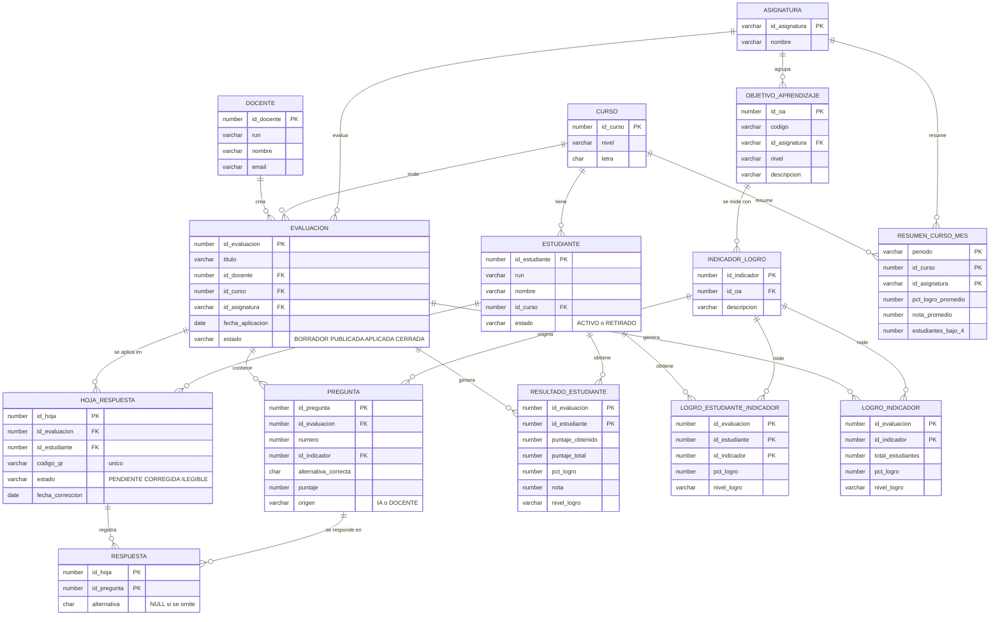
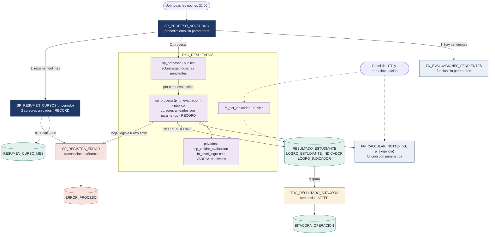
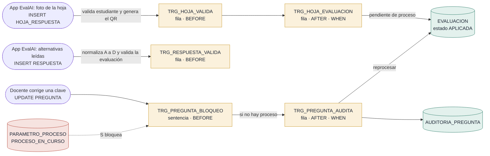

BDY1103 · Taller de Base de Datos  
Evaluación Parcial N°2 · Segunda entrega del proyecto semestral

# Informe N°2

## Programas almacenados para el procesamiento de resultados

**Proyecto EvalAI:** plataforma de generación y corrección de evaluaciones con IA

| Campo | Detalle |
|---|---|
| **Asignatura**       | BDY1103 Taller de Base de Datos                                              |
| **Carrera**          | Analista Programador · Escuela de Informática y Telecomunicaciones · Duoc UC |
| **Sección**          | \[Sección\]                                                                  |
| **Docente**          | \[Nombre del docente\]                                                       |
| **Equipo**           | Equipo docente (modelo):<br>Camila Soto<br>Diego Muñoz<br>Valentina Rojas    |
| **Fecha de entrega** | Semana 12 · 26 al 30 de octubre de 2026                                      |

---

## Contenido

- [Ficha del documento](#ficha-del-documento)
- [1. Introducción](#1-introducción)
  - [1.1 Descripción del proyecto](#11-descripción-del-proyecto)
  - [1.2 Alcance](#12-alcance)
  - [1.3 Tecnologías utilizadas](#13-tecnologías-utilizadas)
- [2. Contexto de negocio y datos](#2-contexto-de-negocio-y-datos)
  - [2.1 El cliente](#21-el-cliente)
  - [2.2 El problema](#22-el-problema)
  - [2.3 Reglas de negocio del procesamiento](#23-reglas-de-negocio-del-procesamiento)
  - [2.4 Datos a procesar e información a generar](#24-datos-a-procesar-e-información-a-generar)
  - [2.5 Modelo de datos](#25-modelo-de-datos)
  - [2.6 Arquitectura de la solución](#26-arquitectura-de-la-solución)
  - [2.7 Trazabilidad con los requisitos de EvalAI](#27-trazabilidad-con-los-requisitos-de-evalai)
- [3. Tipos de datos compuestos (IE1.1.1)](#3-tipos-de-datos-compuestos-ie111)
  - [3.1 Dónde se usan](#31-dónde-se-usan)
  - [3.2 RECORD: el resultado como una unidad](#32-record-el-resultado-como-una-unidad)
  - [3.3 VARRAY: los niveles de logro](#33-varray-los-niveles-de-logro)
- [4. Cursores explícitos complejos (IE1.2.1)](#4-cursores-explícitos-complejos-ie121)
  - [4.1 Conceptos](#41-conceptos)
  - [4.2 Los cursores del procesamiento de resultados](#42-los-cursores-del-procesamiento-de-resultados)
  - [4.3 Por qué cursores anidados y no una sola consulta](#43-por-qué-cursores-anidados-y-no-una-sola-consulta)
- [5. Control de excepciones (IE1.3.1)](#5-control-de-excepciones-ie131)
  - [5.1 Excepciones predefinidas por Oracle](#51-excepciones-predefinidas-por-oracle)
  - [5.2 Excepciones definidas por el usuario](#52-excepciones-definidas-por-el-usuario)
  - [5.3 Integración en el proceso masivo](#53-integración-en-el-proceso-masivo)
  - [5.4 Cómo protege la integridad de los datos](#54-cómo-protege-la-integridad-de-los-datos)
- [6. Procedimientos y funciones (IE2.1.1 · IE2.1.3)](#6-procedimientos-y-funciones-ie211--ie213)
  - [6.1 Definición y características](#61-definición-y-características)
  - [6.2 Procedimientos del proyecto](#62-procedimientos-del-proyecto)
  - [6.3 Funciones del proyecto](#63-funciones-del-proyecto)
- [7. Package (IE2.2.1)](#7-package-ie221)
  - [7.1 Definición y características](#71-definición-y-características)
  - [7.2 PKG_RESULTADOS: especificación](#72-pkg_resultados-especificación)
  - [7.3 Qué es público y qué es privado](#73-qué-es-público-y-qué-es-privado)
  - [7.4 Relación con los procedimientos y funciones](#74-relación-con-los-procedimientos-y-funciones)
  - [7.5 Ventajas y desventajas](#75-ventajas-y-desventajas)
- [8. Triggers (IE2.3.1)](#8-triggers-ie231)
  - [8.1 Definición y características](#81-definición-y-características)
  - [8.2 Triggers del proyecto](#82-triggers-del-proyecto)
  - [8.3 Trigger de fila: validación de la hoja y código QR](#83-trigger-de-fila-validación-de-la-hoja-y-código-qr)
  - [8.4 Trigger de sentencia: preguntas bloqueadas durante el proceso](#84-trigger-de-sentencia-preguntas-bloqueadas-durante-el-proceso)
  - [8.5 Ventajas, desventajas y riesgos](#85-ventajas-desventajas-y-riesgos)
- [9. Pruebas y resultados](#9-pruebas-y-resultados)
  - [9.1 Ejecución del proceso de octubre de 2026](#91-ejecución-del-proceso-de-octubre-de-2026)
  - [9.2 Pruebas de los casos de error y de los triggers](#92-pruebas-de-los-casos-de-error-y-de-los-triggers)
- [10. Conclusión](#10-conclusión)
  - [10.1 Resumen](#101-resumen)
  - [10.2 Impacto en el proyecto EvalAI](#102-impacto-en-el-proyecto-evalai)
  - [10.3 Recomendaciones](#103-recomendaciones)
- [Anexo A. Código de los objetos PL/SQL](#anexo-a-código-de-los-objetos-plsql)
  - [A.1 Triggers](#a1-triggers)
  - [A.2 Procedimientos, funciones y package](#a2-procedimientos-funciones-y-package)
- [Anexo B. Script de ejecución y pruebas](#anexo-b-script-de-ejecución-y-pruebas)

---

# Ficha del documento

La ficha registra las versiones del proyecto semestral y quiénes las elaboraron. Cada entrega agrega una fila.

| **Fecha**                                 | **Revisión** | **Autor**     | **Modificación**                                                                                                                                                                |
|-------------------------------------------|--------------|---------------|---------------------------------------------------------------------------------------------------------------------------------------------------------------------------------|
| Semana 6 · 14 al 18 de septiembre de 2026 | 1.0          | Equipo EvalAI | Primera parte: bloques anónimos con RECORD, VARRAY, cursores y excepciones para corregir una evaluación (entregados como código).                                               |
| Semana 12 · 26 al 30 de octubre de 2026   | 2.0          | Equipo EvalAI | Informe N°2: la lógica de la primera parte pasa a procedimientos, funciones, un package y triggers. Se documentan también los contenidos de la primera parte (secciones 3 a 5). |

**Integrantes**

| **Integrante**  | **Responsabilidad principal en esta entrega**                                      |
|-----------------|------------------------------------------------------------------------------------|
| Camila Soto     | Package PKG_RESULTADOS, procedimientos y cursores del procesamiento de resultados. |
| Diego Muñoz     | Funciones almacenadas, control de excepciones y tabla de errores.                  |
| Valentina Rojas | Triggers, script de carga y pruebas.                                               |

*Todos los integrantes revisaron el código completo y pueden explicar cualquier objeto en la defensa.*

# 1. Introducción

EvalAI es la plataforma web del proyecto semestral: genera evaluaciones con inteligencia artificial a partir de un Objetivo de Aprendizaje (OA) y sus indicadores de logro, permite aplicarlas en línea o impresas con una hoja de respuestas identificada con un código QR, las corrige leyendo una fotografía de esa hoja y reporta el nivel de logro por indicador, estudiante, curso y asignatura.

Este informe cubre la **capa de base de datos** de EvalAI. Cuando la aplicación termina de leer una foto, deja en la base de datos qué alternativa marcó el estudiante en cada pregunta. Desde ahí, todo el trabajo es de la base de datos: validar que la hoja corresponde al estudiante y a la evaluación correctos, calcular puntajes, notas y niveles de logro, y entregar al coordinador académico (UTP) el logro de cada curso por indicador.

En la primera entrega el equipo resolvió la corrección de una evaluación con bloques PL/SQL anónimos, que se ejecutaban a mano. En esta entrega esa lógica se guarda en la base de datos como procedimientos, funciones, un package y triggers, para que el procesamiento ocurra solo cada noche y pueda invocarse desde la aplicación web.

## 1.1 Descripción del proyecto

El objetivo de esta entrega es **automatizar el procesamiento de resultados de EvalAI**: transformar las respuestas leídas desde las fotos en un resultado por estudiante (puntaje, porcentaje de logro, nota y nivel) y en el logro del curso por indicador, y mantener la consistencia de los datos que alimentan ese cálculo.

PL/SQL cumple ese objetivo en tres frentes:

- **Procesamiento masivo:** el package PKG_RESULTADOS recorre evaluaciones, hojas e indicadores con cursores anidados y graba los resultados.

- **Reglas reutilizables:** la función de nota y la del logro por indicador se usan en el proceso y en los reportes, así que cada regla se escribe una sola vez.

- **Control automático:** los triggers validan cada hoja y cada respuesta, generan el código QR, auditan los cambios de clave y protegen las notas.

## 1.2 Alcance

|                        | **Detalle**                                                                                                                                                                                                                                                                                                                                                                |
|------------------------|----------------------------------------------------------------------------------------------------------------------------------------------------------------------------------------------------------------------------------------------------------------------------------------------------------------------------------------------------------------------------|
| **Incluye**            | Cálculo de puntaje, porcentaje de logro, nota y nivel por estudiante; logro por estudiante e indicador (retroalimentación, RF-11); logro del curso por indicador (reporte de UTP, RF-10); resumen mensual por curso y asignatura; validación de hojas y respuestas; código QR (RF-7); auditoría de cambios de clave; bitácora de cambios sobre notas; registro de errores. |
| **No incluye**         | La generación de preguntas con IA y la lectura de la imagen (las hace la aplicación y entrega los datos ya leídos), las pantallas web y la notificación al apoderado (HU-6, fuera del MVP).                                                                                                                                                                                |
| **Usuarios afectados** | Docentes (resultados el mismo día), coordinación académica UTP (logro por indicador) y estudiantes (retroalimentación por indicador).                                                                                                                                                                                                                                      |

## 1.3 Tecnologías utilizadas

| **Tecnología**           | **Uso en el proyecto**                                                                                  |
|--------------------------|---------------------------------------------------------------------------------------------------------|
| Oracle Database 19c      | Base de datos de EvalAI: tablas, datos y objetos PL/SQL.                                                |
| PL/SQL                   | Lenguaje de los procedimientos, funciones, package y triggers.                                          |
| SQL Developer            | Desarrollo, compilación y ejecución del script.                                                         |
| Aplicación web de EvalAI | Genera las preguntas con IA y lee las fotos; inserta preguntas, hojas y respuestas en la base de datos. |
| Oracle APEX (proyección) | Panel de UTP que consulta las funciones del package (sección 10).                                       |
| Graphviz                 | Diagramas del modelo de datos y de la solución.                                                         |

# 2. Contexto de negocio y datos

## 2.1 El cliente

El primer cliente de EvalAI es el Colegio Alerce Andino, una institución **ficticia** creada para este ejemplo: un colegio particular subvencionado de 1° básico a IV medio que pertenece a la Fundación Educacional Alerce Andino.

| Dato | Detalle |
|---|---|
| **Cursos**                    | 36 (3 por nivel), de 32 estudiantes en promedio            |
| **Estudiantes**               | 1.152                                                      |
| **Docentes**                  | 54, que aplican en promedio 2 evaluaciones escritas al mes |
| **Evaluaciones al mes**       | Cerca de 108                                               |
| **Hojas de respuesta al mes** | Cerca de 3.450                                             |
| **Respuestas al mes**         | Cerca de 50.000 (unas 15 preguntas por hoja)               |

*Tabla 1. Volumen que procesa la base de datos. La base de este informe es una muestra (sección 2.4).*

## 2.2 El problema

En la elicitación del proyecto se registró que cada docente corrige hoja por hoja, traspasa los puntajes a una planilla y entrega los resultados unos 10 días después, y que los resultados quedan por prueba y no por objetivo: nadie puede decir qué indicador de logro quedó débil. EvalAI resuelve la lectura de las hojas, pero eso deja a la base de datos tres problemas por resolver:

- **Convertir 50.000 respuestas al mes en información**, con las mismas reglas para todos los cursos: puntaje, nota con 60% de exigencia y nivel de logro por indicador.

- **Recalcular cuando algo cambia:** la IA puede marcar mal la clave de una pregunta y el docente la corrige después (HU-1.3), o una hoja ilegible se fotografía de nuevo (HU-2.2). Los resultados deben reflejar el cambio sin trabajo manual.

- **Proteger datos de menores de edad (RNF-3):** las notas no se pueden modificar sin dejar rastro, y una hoja no puede quedar asignada a un estudiante que no es del curso.

## 2.3 Reglas de negocio del procesamiento

| **ID** | **Regla**                                                                                                                                                     |
|--------|---------------------------------------------------------------------------------------------------------------------------------------------------------------|
| RB-01  | Una pregunta suma su puntaje si la alternativa marcada coincide con la correcta. Omitida o incorrecta suma 0.                                                 |
| RB-02  | Porcentaje de logro = puntaje obtenido / puntaje total × 100, con un decimal. Se calcula por estudiante, por estudiante e indicador, y por curso e indicador. |
| RB-03  | Nota de 1,0 a 7,0 con 60% de exigencia: bajo 60%, nota = 1 + 3 × % / 60; desde 60%, nota = 4 + 3 × (% − 60) / 40. Un decimal.                                 |
| RB-04  | Nivel de logro: menos de 60%, Por lograr; de 60% a menos de 80%, Medianamente logrado; 80% o más, Logrado.                                                    |
| RB-05  | Solo se procesan hojas CORREGIDAS. Una hoja ILEGIBLE no recibe nota y queda registrada para tomar una nueva foto (HU-2.2).                                    |
| RB-06  | Cada hoja corresponde a un estudiante activo del curso de la evaluación y tiene un código QR único (RF-7, RF-8).                                              |
| RB-07  | Si el docente cambia la clave de una pregunta, el cambio se audita y la evaluación se vuelve a procesar.                                                      |
| RB-08  | No se modifican preguntas mientras corre el proceso, y toda operación sobre las notas queda en bitácora (RNF-3).                                              |

*Tabla 2. Reglas de negocio que implementan los programas PL/SQL.*

## 2.4 Datos a procesar e información a generar

El script de este informe crea una **muestra** con 3 cursos (7° A, 7° B y 8° A), 36 estudiantes, 3 docentes, 2 asignaturas, 3 OA con 8 indicadores de logro y 5 evaluaciones de octubre de 2026: 4 aplicadas y 1 publicada que aún no se aplica. Las evaluaciones aplicadas tienen 46 preguntas, 47 hojas de respuesta (una de ellas ilegible) y 528 respuestas. La lógica es la misma que se ejecutaría sobre las 50.000 respuestas de un mes completo.

|                      | **Datos que se procesan**                                              | **Información que se genera**                                                                          |
|----------------------|------------------------------------------------------------------------|--------------------------------------------------------------------------------------------------------|
| **Por estudiante**   | PREGUNTA, HOJA_RESPUESTA y RESPUESTA de cada evaluación aplicada       | RESULTADO_ESTUDIANTE (puntaje, %, nota, nivel) y LOGRO_ESTUDIANTE_INDICADOR (retroalimentación, RF-11) |
| **Por curso**        | Los resultados por indicador de todos los estudiantes de la evaluación | LOGRO_INDICADOR: el reporte de UTP (RF-10, RN-2)                                                       |
| **Por mes**          | RESULTADO_ESTUDIANTE y EVALUACION del periodo                          | RESUMEN_CURSO_MES: logro y nota promedio por curso y asignatura                                        |
| **Operación diaria** | Cada INSERT o UPDATE de HOJA_RESPUESTA, RESPUESTA y PREGUNTA           | Código QR, estado de la evaluación, AUDITORIA_PREGUNTA                                                 |
| **Control**          | Errores y operaciones de los procesos                                  | ERROR_PROCESO y BITACORA_OPERACION                                                                     |

## 2.5 Modelo de datos

El modelo tiene diez tablas de operación: la base curricular (asignatura, OA e indicadores), la comunidad escolar (cursos, estudiantes y docentes) y el ciclo de la evaluación (evaluación, preguntas, hojas y respuestas). Cuatro tablas las generan los procesos (resultados, logro por indicador y resumen mensual) y otras cuatro son de control.



Las tablas de control (ERROR_PROCESO, AUDITORIA_PREGUNTA, BITACORA_OPERACION y PARAMETRO_PROCESO) no tienen claves foráneas y no se muestran en el diagrama.

*Figura 1. Modelo de datos de EvalAI.*

## 2.6 Arquitectura de la solución

La solución tiene dos partes. El **proceso nocturno** (figura 2) lo inicia un procedimiento sin parámetros: revisa si hay evaluaciones pendientes, las procesa con el package y luego genera el resumen del mes. Los errores de cualquier programa terminan en una misma tabla de log. La **operación diaria** (figura 3) la cubren los triggers, que actúan cada vez que la aplicación graba una hoja o una respuesta, o un docente corrige la clave de una pregunta.



*Figura 2. Proceso nocturno: quién invoca a quién y qué tablas escribe cada objeto.*



*Figura 3. Operación diaria: triggers sobre HOJA_RESPUESTA, RESPUESTA y PREGUNTA.*

| **Objeto**                                                                      | **Tipo**                     | **Responsabilidad**                    | **Indicador**               |
|---------------------------------------------------------------------------------|------------------------------|----------------------------------------|-----------------------------|
| SP_PROCESO_NOCTURNO                                                             | Procedimiento sin parámetros | Orquesta el proceso de cada noche      | IE2.1.1                     |
| SP_RESUMEN_CURSOS                                                               | Procedimiento con parámetros | Resumen mensual por curso y asignatura | IE2.1.1 · IE1.2.1           |
| SP_REGISTRA_ERROR                                                               | Procedimiento con parámetros | Registro de errores                    | IE2.1.1 · IE1.3.1           |
| FN_CALCULAR_NOTA                                                                | Función con parámetros       | Nota según el % de logro (RB-03)       | IE2.1.3                     |
| FN_EVALUACIONES_PENDIENTES                                                      | Función sin parámetros       | Evaluaciones que esperan proceso       | IE2.1.3                     |
| PKG_RESULTADOS                                                                  | Package                      | Procesamiento y consulta de resultados | IE2.2.1 · IE1.1.1 · IE1.2.1 |
| TRG_HOJA_VALIDA, TRG_HOJA_EVALUACION, TRG_RESPUESTA_VALIDA, TRG_PREGUNTA_AUDITA | Triggers de fila             | Validación, QR, estado y auditoría     | IE2.3.1                     |
| TRG_PREGUNTA_BLOQUEO, TRG_RESULTADO_BITACORA                                    | Triggers de sentencia        | Bloqueo durante el proceso y bitácora  | IE2.3.1                     |

*Tabla 3. Objetos PL/SQL de la solución y el indicador de la pauta que evidencian.*

## 2.7 Trazabilidad con los requisitos de EvalAI

Los requisitos se definieron en Ingeniería de Requisitos. La tabla muestra qué objeto de la base de datos implementa cada uno.

| **Requisito**         | **Qué pide**                                                                   | **Dónde se implementa**                                                                                   |
|-----------------------|--------------------------------------------------------------------------------|-----------------------------------------------------------------------------------------------------------|
| RF-7 · RF-8           | QR único por evaluación y estudiante; la hoja se asocia al estudiante correcto | TRG_HOJA_VALIDA genera el QR y valida estudiante y curso; UNIQUE (id_evaluacion, id_estudiante)           |
| RF-9 · HU-2.1         | Puntaje calculado sin intervención del docente                                 | PKG_RESULTADOS.sp_procesar                                                                                |
| HU-2.2                | Una foto ilegible no registra resultado y pide otra                            | Excepción e_hoja_sin_corregir y ERROR_PROCESO; TRG_HOJA_EVALUACION reabre la evaluación con la nueva foto |
| RF-10 · RN-2 · HU-3.1 | Logro por indicador, curso y asignatura                                        | LOGRO_INDICADOR, fn_pct_indicador y RESUMEN_CURSO_MES                                                     |
| RF-11 · HU-5          | El estudiante ve su logro por indicador                                        | LOGRO_ESTUDIANTE_INDICADOR                                                                                |
| RF-5 · HU-1.3         | El docente puede corregir una pregunta generada por la IA                      | TRG_PREGUNTA_AUDITA audita y deja la evaluación pendiente                                                 |
| RNF-3                 | Datos de estudiantes protegidos                                                | TRG_RESULTADO_BITACORA y validaciones de los triggers de hoja                                             |

*Tabla 4. Requisitos de EvalAI y objetos de la base de datos que los cumplen.*

# 3. Tipos de datos compuestos (IE1.1.1)

Un tipo de dato compuesto agrupa varios valores en una sola variable. PL/SQL ofrece dos que el proyecto usa: el **RECORD**, que agrupa campos de distinto tipo (como una fila), y el **VARRAY**, que guarda una lista ordenada de elementos del mismo tipo con un tamaño máximo fijo.

## 3.1 Dónde se usan

| **Variable**          | **Tipo**                              | **Programa**               | **Para qué**                                                                |
|-----------------------|---------------------------------------|----------------------------|-----------------------------------------------------------------------------|
| r_res                 | RECORD (resultado_estudiante%ROWTYPE) | PKG_RESULTADOS.sp_procesar | Arma el resultado de un estudiante y lo graba con una sola instrucción.     |
| r_lei, r_li           | RECORD (%ROWTYPE)                     | PKG_RESULTADOS.sp_procesar | Logro por estudiante e indicador, y logro del curso por indicador.          |
| r_eval                | RECORD propio (t_total_eval)          | PKG_RESULTADOS.sp_procesar | Acumula hojas, suma de % y suma de notas para el promedio de la evaluación. |
| r_menor               | RECORD propio (t_menor)               | SP_RESUMEN_CURSOS          | Guarda el curso y la asignatura con menor logro del mes.                    |
| v_umbrales, v_niveles | VARRAY (t_umbrales, t_niveles)        | PKG_RESULTADOS (privado)   | Umbrales y nombres de los niveles de logro de la regla RB-04.               |

## 3.2 RECORD: el resultado como una unidad

Un resultado tiene ocho columnas. En vez de ocho variables sueltas, el procedimiento declara registros con la misma estructura de las tablas (%ROWTYPE) y un registro propio para los totales de la evaluación:

```sql
TYPE t_total_eval IS RECORD (
  hojas     NUMBER := 0,
  suma_pct  NUMBER := 0,
  suma_nota NUMBER := 0
);
r_eval  t_total_eval;
r_res   resultado_estudiante%ROWTYPE;
r_vacio resultado_estudiante%ROWTYPE;
r_lei   logro_estudiante_indicador%ROWTYPE;
r_li    logro_indicador%ROWTYPE;
```

Al terminar de calcular, el registro completo se inserta con una sola instrucción. Si la evaluación ya se había procesado (por ejemplo, después de corregir una clave), la misma variable reemplaza la fila con UPDATE … SET ROW:

```sql
BEGIN
  INSERT INTO resultado_estudiante VALUES r_res;
EXCEPTION
  WHEN DUP_VAL_ON_INDEX THEN     -- re-proceso: se reemplaza el resultado
    UPDATE resultado_estudiante
       SET ROW = r_res
     WHERE id_evaluacion = p_id_evaluacion
       AND id_estudiante = reg_hoja.id_estudiante;
END;
```

Como los registros se declaran con %ROWTYPE, si mañana se agrega una columna a RESULTADO_ESTUDIANTE el registro la incorpora solo. Antes de cada hoja, r_res se limpia asignándole r_vacio, para que ningún valor del estudiante anterior pase al siguiente.

## 3.3 VARRAY: los niveles de logro

Los niveles de la regla RB-04 son tres y los fija el reglamento de evaluación del colegio, por eso se guardan en dos VARRAY: uno con los umbrales (60 y 80) y otro con los nombres de los tres niveles. Se declaran en el cuerpo del package, como privados, y se cargan una sola vez en su bloque de inicialización:

```sql
  TYPE t_umbrales IS VARRAY(2) OF NUMBER(3);
  TYPE t_niveles  IS VARRAY(3) OF VARCHAR2(25);
  v_umbrales  t_umbrales;   -- % mínimo de cada nivel superior
  v_niveles   t_niveles;    -- nombre de cada nivel de logro
  ...
BEGIN
  -- inicialización del package: niveles de logro del colegio
  v_umbrales := t_umbrales(60, 80);
  v_niveles  := t_niveles('POR LOGRAR', 'MEDIANAMENTE LOGRADO', 'LOGRADO');
END pkg_resultados;
```

La función privada fn_nivel_logro recorre los umbrales con COUNT y se queda con el último nivel que el porcentaje alcanza. La misma función clasifica al estudiante, al estudiante por indicador y al curso por indicador:

```sql
FUNCTION fn_nivel_logro (p_pct IN NUMBER) RETURN VARCHAR2 IS
  v_nivel  VARCHAR2(25) := v_niveles(1);
BEGIN
  FOR i IN 1 .. v_umbrales.COUNT LOOP
    IF p_pct >= v_umbrales(i) THEN
      v_nivel := v_niveles(i + 1);
    END IF;
  END LOOP;
  RETURN v_nivel;
END fn_nivel_logro;
```

**Por qué mejora el procesamiento:** el VARRAY vive en memoria durante la sesión, así que clasificar unas 10.000 filas de logro al mes no requiere ninguna consulta adicional. Si el colegio agrega un cuarto nivel (por ejemplo, «Destacado»), solo se cambian los límites de los tipos y la inicialización; el recorrido no cambia.

# 4. Cursores explícitos complejos (IE1.2.1)

## 4.1 Conceptos

Un **cursor explícito** es una consulta con nombre, declarada por el programador, cuyas filas se recorren una a una. Se usa cuando una consulta devuelve varias filas y cada una debe procesarse con lógica que SQL solo no puede expresar, como aplicar reglas distintas por fila, acumular totales o controlar errores fila a fila. Un SELECT INTO, en cambio, solo sirve para una fila.

|                    | **Cursor simple**                        | **Cursor complejo**                                                                                 |
|--------------------|------------------------------------------|-----------------------------------------------------------------------------------------------------|
| **Consulta**       | Fija: siempre devuelve las mismas filas. | Recibe **parámetros**: la misma consulta devuelve filas distintas según el valor que se le entrega. |
| **Uso típico**     | Un solo recorrido.                       | Varios cursores en **loops anidados**: el externo entrega valores al interno (maestro-detalle).     |
| **En el proyecto** | c_pendientes                             | c_hojas(p_id_eval) → c_indicadores(p_id_eval, p_id_hoja)                                            |

Los parámetros se declaran en el cursor y se entregan al abrirlo: c_indicadores(p_id_evaluacion, reg_hoja.id_hoja). Así cada vuelta del loop externo abre el interno con un valor nuevo, sin concatenar SQL ni repetir la consulta.

## 4.2 Los cursores del procesamiento de resultados

PKG_RESULTADOS.sp_procesar trabaja con dos cursores anidados con parámetros. c_indicadores usa un LEFT JOIN desde PREGUNTA para que una pregunta omitida (sin fila en RESPUESTA) cuente en el puntaje posible:

```sql
CURSOR c_hojas (p_id_eval NUMBER) IS
  SELECT h.id_hoja, h.id_estudiante, h.estado
    FROM hoja_respuesta h
   WHERE h.id_evaluacion = p_id_eval
   ORDER BY h.id_estudiante;

CURSOR c_indicadores (p_id_eval NUMBER, p_id_hoja NUMBER) IS
  SELECT p.id_indicador,
         SUM(CASE WHEN r.alternativa = p.alternativa_correcta
                  THEN p.puntaje ELSE 0 END)  AS obtenido,
         SUM(p.puntaje)                       AS posible
    FROM pregunta p
    LEFT JOIN respuesta r
           ON r.id_pregunta = p.id_pregunta
          AND r.id_hoja = p_id_hoja
   WHERE p.id_evaluacion = p_id_eval
   GROUP BY p.id_indicador
   ORDER BY p.id_indicador;
```

| **Cursor**    | **Parámetros**       | **Qué recorre**                                                          |
|---------------|----------------------|--------------------------------------------------------------------------|
| c_pendientes  | —                    | Evaluaciones en estado APLICADA (sobrecarga sin parámetros del package). |
| c_hojas       | p_id_eval            | Las hojas de la evaluación, con el estudiante y el estado de la foto.    |
| c_indicadores | p_id_eval, p_id_hoja | Puntaje obtenido y posible de esa hoja, agrupado por indicador de logro. |
| c_agregado    | p_id_eval            | Logro del curso por indicador, al terminar las hojas.                    |

Los loops trabajan al mismo tiempo: mientras el loop de hojas está en un estudiante, el de indicadores recorre sus indicadores y graba el logro de cada uno:

```sql
FOR reg_hoja IN c_hojas(p_id_evaluacion) LOOP                     -- loop: hojas
  SAVEPOINT sp_hoja;
  BEGIN
    IF reg_hoja.estado <> 'CORREGIDA' THEN
      RAISE e_hoja_sin_corregir;
    END IF;

    r_res                  := r_vacio;
    r_res.id_evaluacion    := p_id_evaluacion;
    r_res.id_estudiante    := reg_hoja.id_estudiante;
    r_res.puntaje_obtenido := 0;
    r_res.puntaje_total    := 0;

    FOR reg_ind IN c_indicadores(p_id_evaluacion, reg_hoja.id_hoja) LOOP  -- loop anidado: indicadores
      r_lei.id_evaluacion    := p_id_evaluacion;
      r_lei.id_estudiante    := reg_hoja.id_estudiante;
      r_lei.id_indicador     := reg_ind.id_indicador;
      r_lei.puntaje_obtenido := reg_ind.obtenido;
      r_lei.puntaje_total    := reg_ind.posible;
      r_lei.pct_logro        := ROUND(reg_ind.obtenido / reg_ind.posible * 100, 1);
      r_lei.nivel_logro      := fn_nivel_logro(r_lei.pct_logro);
      INSERT INTO logro_estudiante_indicador VALUES r_lei;

      r_res.puntaje_obtenido := r_res.puntaje_obtenido + reg_ind.obtenido;
      r_res.puntaje_total    := r_res.puntaje_total + reg_ind.posible;
    END LOOP;
```

Un tercer nivel está por fuera: la versión sin parámetros de sp_procesar recorre las evaluaciones pendientes y, para cada una, ejecuta los dos loops anteriores. SP_RESUMEN_CURSOS aplica el mismo patrón: c_cursos → c_asignaturas(p_id_curso, p_per).

```sql
PROCEDURE sp_procesar IS
  CURSOR c_pendientes IS
    SELECT id_evaluacion
      FROM evaluacion
     WHERE estado = 'APLICADA'
     ORDER BY id_evaluacion;
BEGIN
  g_hojas_procesadas := 0;
  g_hojas_omitidas   := 0;
  FOR reg_ev IN c_pendientes LOOP                                    -- loop externo: evaluaciones
    sp_procesar(reg_ev.id_evaluacion);
  END LOOP;
  DBMS_OUTPUT.PUT_LINE('Hojas procesadas: ' || g_hojas_procesadas
                       || ' · hojas omitidas: ' || g_hojas_omitidas);
END sp_procesar;
```

## 4.3 Por qué cursores anidados y no una sola consulta

Un único SELECT con GROUP BY podría sumar los puntajes, pero el procesamiento necesita decisiones por hoja que se resuelven mejor dentro del loop:

- Una hoja **ilegible** se omite y se registra (RB-05) sin detener a las demás: cada hoja tiene su propio bloque de excepciones y su SAVEPOINT.

- La **nota** usa una fórmula distinta bajo y sobre la exigencia (RB-03), y el nivel se calcula con el VARRAY: ambas reglas viven en PL/SQL.

- El mismo recorrido graba **tres resultados** distintos: por estudiante e indicador, por estudiante y, al final, por curso e indicador.

**Ventaja para grandes volúmenes:** el cursor de indicadores ya llega agrupado desde la base de datos (como mucho tres filas por hoja), así que PL/SQL no recorre las 50.000 respuestas una a una. El cursor FOR abre, recorre y cierra cada cursor solo, aunque ocurra un error.

# 5. Control de excepciones (IE1.3.1)

Una excepción es un error que ocurre durante la ejecución de un bloque PL/SQL. Cuando ocurre, el bloque deja de ejecutarse y el control pasa a su sección EXCEPTION; si no hay un manejador, el error se propaga al bloque que lo invocó. El proyecto usa excepciones de dos tipos.

## 5.1 Excepciones predefinidas por Oracle

| **Excepción**    | **Dónde**                             | **Condición y tratamiento**                                                                                                                              |
|------------------|---------------------------------------|----------------------------------------------------------------------------------------------------------------------------------------------------------|
| NO_DATA_FOUND    | TRG_HOJA_VALIDA, TRG_RESPUESTA_VALIDA | El estudiante, la evaluación, la hoja o la pregunta no existe: se rechaza con un mensaje claro (-20001, -20006) antes de que la FK dé un error genérico. |
| NO_DATA_FOUND    | sp_validar_evaluacion                 | La evaluación no existe: se convierte en la excepción de negocio e_evaluacion_invalida.                                                                  |
| NO_DATA_FOUND    | PKG_RESULTADOS.fn_pct_indicador       | El indicador no se evaluó: la función devuelve NULL en vez de fallar, porque se usa dentro de un SELECT.                                                 |
| DUP_VAL_ON_INDEX | PKG_RESULTADOS.sp_procesar            | El resultado del estudiante ya existe (re-proceso): se reemplaza con UPDATE … SET ROW.                                                                   |
| OTHERS           | Package, procedimientos               | Cualquier otro error en una hoja: se deshace lo que alcanzó a grabar (ROLLBACK TO SAVEPOINT), se registra con SQLERRM y el proceso sigue.                |

## 5.2 Excepciones definidas por el usuario

Las excepciones de usuario protegen reglas de negocio que para Oracle no son errores. Se declaran con EXCEPTION y se lanzan con RAISE, o se lanzan con RAISE_APPLICATION_ERROR cuando el mensaje debe llegar a la aplicación:

| **Excepción**         | **Dónde**                             | **Regla que protege**                                                                                   |
|-----------------------|---------------------------------------|---------------------------------------------------------------------------------------------------------|
| e_hoja_sin_corregir   | PKG_RESULTADOS                        | RB-05: la hoja ilegible se omite, se registra y el proceso sigue.                                       |
| e_evaluacion_invalida | PKG_RESULTADOS                        | Solo se procesan evaluaciones aplicadas; termina con RAISE_APPLICATION_ERROR(-20010).                   |
| e_sin_resultados      | SP_RESUMEN_CURSOS                     | No se deja un resumen vacío: deshace el DELETE y registra el aviso.                                     |
| -20001 a -20006       | TRG_HOJA_VALIDA, TRG_RESPUESTA_VALIDA | RB-06: estudiante retirado o de otro curso; alternativa distinta de A a D; pregunta de otra evaluación. |
| -20020                | TRG_PREGUNTA_BLOQUEO                  | RB-08: preguntas bloqueadas durante el proceso.                                                         |

La validación de la evaluación muestra cómo un error de Oracle (NO_DATA_FOUND) y una condición de negocio (evaluación no aplicada) terminan en la misma excepción de usuario:

```sql
PROCEDURE sp_validar_evaluacion (p_id_evaluacion IN NUMBER) IS
  v_estado  evaluacion.estado%TYPE;
BEGIN
  SELECT estado INTO v_estado
    FROM evaluacion
   WHERE id_evaluacion = p_id_evaluacion;
  IF v_estado NOT IN ('APLICADA', 'CERRADA') THEN
    RAISE e_evaluacion_invalida;     -- borrador o publicada: aún no hay hojas
  END IF;
EXCEPTION
  WHEN NO_DATA_FOUND THEN
    RAISE e_evaluacion_invalida;     -- la evaluación no existe
END sp_validar_evaluacion;
```

## 5.3 Integración en el proceso masivo

Cada hoja se procesa dentro de su propio bloque BEGIN … EXCEPTION … END, precedido por un SAVEPOINT. Si su cálculo falla, se deshace solo lo de esa hoja, el error se registra y el loop sigue con la siguiente; un problema en una hoja no detiene las otras 3.449 del mes:

```sql
  EXCEPTION
    WHEN e_hoja_sin_corregir THEN
      g_hojas_omitidas := g_hojas_omitidas + 1;
      sp_registra_error('PKG_RESULTADOS.SP_PROCESAR',
        'Evaluación ' || p_id_evaluacion || ': hoja ' || reg_hoja.id_hoja || ' del estudiante '
        || reg_hoja.id_estudiante || ' en estado ' || reg_hoja.estado || ', requiere nueva foto.');
    WHEN OTHERS THEN               -- un error en una hoja no detiene el proceso
      ROLLBACK TO sp_hoja;         -- deshace lo que alcanzó a grabar esa hoja
      g_hojas_omitidas := g_hojas_omitidas + 1;
      sp_registra_error('PKG_RESULTADOS.SP_PROCESAR',
        'Evaluación ' || p_id_evaluacion || ', hoja ' || reg_hoja.id_hoja || ': ' || SQLERRM);
  END;
END LOOP;
```

Los errores se guardan con SP_REGISTRA_ERROR, que usa **PRAGMA AUTONOMOUS_TRANSACTION**: hace COMMIT de su propia inserción sin confirmar ni deshacer la transacción del proceso. Así el registro del error se conserva aunque el proceso termine con ROLLBACK.

## 5.4 Cómo protege la integridad de los datos

- Ningún estudiante queda con un resultado a medias: el SAVEPOINT por hoja y un solo COMMIT por evaluación lo impiden.

- Los triggers rechazan antes de grabar las hojas de estudiantes que no son del curso y las respuestas con alternativas no válidas, así que los datos de origen ya llegan limpios.

- Las excepciones de usuario devuelven mensajes de negocio (por ejemplo, «El estudiante 2025 no pertenece al curso de la evaluación 1001»), que la aplicación puede mostrar tal cual.

# 6. Procedimientos y funciones (IE2.1.1 · IE2.1.3)

## 6.1 Definición y características

Un **procedimiento almacenado** es un bloque PL/SQL con nombre que se compila y se guarda en la base de datos. Ejecuta una acción (procesar, insertar, actualizar) y puede recibir y devolver datos por parámetros IN, OUT o IN OUT. Una **función almacenada** también se guarda compilada, pero siempre devuelve un valor con RETURN, por lo que se puede usar dentro de una expresión: en otro programa PL/SQL o en una sentencia SQL.

|                 | **Procedimiento**                                                                                                       | **Función**                                                                                            |
|-----------------|-------------------------------------------------------------------------------------------------------------------------|--------------------------------------------------------------------------------------------------------|
| **Propósito**   | Ejecutar una acción o un proceso.                                                                                       | Calcular y devolver un valor.                                                                          |
| **Se invoca**   | Como instrucción: EXEC o desde otro bloque.                                                                             | Dentro de una expresión: variable := fn(…) o SELECT fn(…).                                             |
| **Uso en SQL**  | No.                                                                                                                     | Sí, si no modifica datos (sin DML ni COMMIT).                                                          |
| **Ventajas**    | Centraliza procesos; se programa como tarea automática; reduce tráfico de red (un llamado en vez de muchas sentencias). | Reutiliza una regla de cálculo en procesos y reportes; mantiene la regla en un solo lugar.             |
| **Desventajas** | Si concentra demasiada lógica, es difícil de probar y depurar.                                                          | Usada en un SELECT sobre muchas filas, se ejecuta una vez por fila: puede ser lenta si hace consultas. |

Ambos se compilan una vez y quedan en el diccionario de datos (USER_OBJECTS, USER_SOURCE). Si cambia una tabla de la que dependen, Oracle los marca como inválidos y los recompila en el siguiente uso.

## 6.2 Procedimientos del proyecto

| **Procedimiento**          | **Parámetros**                                   | **Propósito y quién lo invoca**                                                                             |
|----------------------------|--------------------------------------------------|-------------------------------------------------------------------------------------------------------------|
| SP_PROCESO_NOCTURNO        | Ninguno                                          | Procesa todas las evaluaciones pendientes y resume el mes. Lo invoca un job cada noche, o un administrador. |
| SP_RESUMEN_CURSOS          | p_periodo IN                                     | Genera el resumen mensual por curso y asignatura. Lo invoca SP_PROCESO_NOCTURNO.                            |
| SP_REGISTRA_ERROR          | p_subprograma IN, p_mensaje IN                   | Registra un error. Lo invocan el package y los otros procedimientos.                                        |
| PKG_RESULTADOS.sp_procesar | p_id_evaluacion IN (y sobrecarga sin parámetros) | Procesa una evaluación o todas las pendientes (sección 7).                                                  |

**Procedimiento sin parámetros.** SP_PROCESO_NOCTURNO no necesita que le digan qué procesar: pregunta a FN_EVALUACIONES_PENDIENTES si hay trabajo. Eso lo hace apto para programarlo como tarea automática. Además marca el proceso en curso, que es lo que activa el bloqueo de preguntas (sección 8):

```sql
CREATE OR REPLACE PROCEDURE sp_proceso_nocturno IS
BEGIN
  IF fn_evaluaciones_pendientes = 0 THEN
    DBMS_OUTPUT.PUT_LINE('No hay evaluaciones pendientes.');
    RETURN;
  END IF;
  UPDATE parametro_proceso SET valor = 'S' WHERE nombre = 'PROCESO_EN_CURSO';
  COMMIT;

  pkg_resultados.sp_procesar;
  sp_resumen_cursos(TO_CHAR(SYSDATE, 'YYYYMM'));

  UPDATE parametro_proceso SET valor = 'N' WHERE nombre = 'PROCESO_EN_CURSO';
  COMMIT;
EXCEPTION
  WHEN OTHERS THEN
    UPDATE parametro_proceso SET valor = 'N' WHERE nombre = 'PROCESO_EN_CURSO';
    COMMIT;
    sp_registra_error('SP_PROCESO_NOCTURNO', SQLERRM);
    RAISE;
END sp_proceso_nocturno;
/
```

**Procedimientos con parámetros.** SP_RESUMEN_CURSOS recibe el periodo para poder rehacer el resumen de cualquier mes; su código completo está en el Anexo A. SP_REGISTRA_ERROR recibe qué programa falló y el mensaje:

```sql
CREATE OR REPLACE PROCEDURE sp_registra_error (
  p_subprograma  IN VARCHAR2,
  p_mensaje      IN VARCHAR2
) IS
  PRAGMA AUTONOMOUS_TRANSACTION;
BEGIN
  INSERT INTO error_proceso
  VALUES (seq_error.NEXTVAL, SUBSTR(p_subprograma, 1, 60), SUBSTR(p_mensaje, 1, 400), USER, SYSDATE);
  COMMIT;
END sp_registra_error;
/
```

## 6.3 Funciones del proyecto

| **Función**                     | **Parámetros**                  | **Devuelve · dónde se usa**                                           |
|---------------------------------|---------------------------------|-----------------------------------------------------------------------|
| FN_CALCULAR_NOTA                | p_pct, p_exigencia (opcional)   | Nota de 1,0 a 7,0 (RB-03) · en PKG_RESULTADOS y en los reportes SQL.  |
| FN_EVALUACIONES_PENDIENTES      | Ninguno                         | Cantidad de evaluaciones APLICADAS · en SP_PROCESO_NOCTURNO y en SQL. |
| PKG_RESULTADOS.fn_pct_indicador | p_id_evaluacion, p_id_indicador | % de logro del curso en el indicador, o NULL · panel de UTP.          |

FN_CALCULAR_NOTA toma por defecto la exigencia pública del package; si el colegio usara otra exigencia en una evaluación, basta con entregarla como segundo parámetro:

```sql
CREATE OR REPLACE FUNCTION fn_calcular_nota (
  p_pct        IN NUMBER,
  p_exigencia  IN NUMBER DEFAULT pkg_resultados.c_exigencia
) RETURN NUMBER IS
  v_nota  NUMBER;
BEGIN
  IF p_pct < p_exigencia THEN
    v_nota := 1 + 3 * p_pct / p_exigencia;
  ELSE
    v_nota := 4 + 3 * (p_pct - p_exigencia) / (100 - p_exigencia);
  END IF;
  RETURN ROUND(v_nota, 1);
END fn_calcular_nota;
/
```

```sql
CREATE OR REPLACE FUNCTION fn_evaluaciones_pendientes RETURN NUMBER IS
  v_total  NUMBER;
BEGIN
  SELECT COUNT(*) INTO v_total
    FROM evaluacion
   WHERE estado = 'APLICADA';
  RETURN v_total;
END fn_evaluaciones_pendientes;
/
```

**Uso en sentencias SQL.** El reporte de UTP llama a la función del package dentro del SELECT, y el de resultados vuelve a calcular la nota con FN_CALCULAR_NOTA para verificar la grabada. Las funciones no modifican datos, por eso Oracle permite usarlas en una consulta:

```sql
SELECT e.id_evaluacion, c.nivel || ' ' || c.letra AS curso, i.id_indicador, i.descripcion,
       pkg_resultados.fn_pct_indicador(e.id_evaluacion, i.id_indicador) AS pct_logro,
       li.nivel_logro
  FROM logro_indicador li
  JOIN evaluacion e      ON e.id_evaluacion = li.id_evaluacion
  JOIN curso c           ON c.id_curso = e.id_curso
  JOIN indicador_logro i ON i.id_indicador = li.id_indicador
 ORDER BY e.id_evaluacion, i.id_indicador;
```

```sql
SELECT fn_evaluaciones_pendientes AS pendientes FROM dual;              -- 4
SELECT fn_calcular_nota(75) AS nota_75, fn_calcular_nota(30) FROM dual;  -- 5,1 · 2,5
```

**Por qué estas lógicas son funciones y no procedimientos:** las tres devuelven un solo valor y se necesitan dentro de consultas (reportes y panel de UTP). Un procedimiento con un parámetro OUT entregaría el mismo valor, pero no se podría usar en un SELECT.

# 7. Package (IE2.2.1)

## 7.1 Definición y características

Un **package** agrupa en un solo objeto de la base de datos procedimientos, funciones, variables, constantes, tipos, cursores y excepciones relacionados. Tiene dos partes que se compilan por separado:

- La **especificación** declara lo **público**: lo que otros programas pueden usar con la notación paquete.elemento.

- El **cuerpo** implementa lo declarado y contiene lo **privado**: elementos que solo existen dentro del package.

La primera vez que una sesión usa el package, Oracle lo carga en memoria y ejecuta su bloque de inicialización. Desde ahí, sus variables mantienen su valor durante toda la sesión.

## 7.2 PKG_RESULTADOS: especificación

```sql
CREATE OR REPLACE PACKAGE pkg_resultados IS
  -- constructores públicos
  c_exigencia           CONSTANT NUMBER := 60;   -- % de logro para la nota 4,0
  g_hojas_procesadas    NUMBER := 0;
  g_hojas_omitidas      NUMBER := 0;

  PROCEDURE sp_procesar (p_id_evaluacion IN NUMBER);
  PROCEDURE sp_procesar;   -- sobrecarga: todas las evaluaciones pendientes
  FUNCTION  fn_pct_indicador (p_id_evaluacion IN NUMBER, p_id_indicador IN NUMBER) RETURN NUMBER;
END pkg_resultados;
/
```

## 7.3 Qué es público y qué es privado

| **Elemento**                                 | **Visibilidad** | **Razón**                                                                                |
|----------------------------------------------|-----------------|------------------------------------------------------------------------------------------|
| sp_procesar(p_id_evaluacion)                 | Público         | La aplicación lo llama para procesar una evaluación en el momento, sin esperar la noche. |
| sp_procesar (sin parámetros)                 | Público         | Sobrecarga que procesa todas las pendientes; la usa el proceso nocturno.                 |
| fn_pct_indicador                             | Público         | La consulta el panel de UTP.                                                             |
| c_exigencia                                  | Público         | FN_CALCULAR_NOTA la usa como valor por defecto: la exigencia vive en un solo lugar.      |
| g_hojas_procesadas, g_hojas_omitidas         | Público         | Quien invoca el proceso puede leer cuántas hojas se procesaron en la sesión.             |
| t_umbrales, t_niveles, v_umbrales, v_niveles | Privado         | Los niveles son un detalle del cálculo; nadie fuera del package debe modificarlos.       |
| sp_validar_evaluacion, fn_nivel_logro        | Privado         | Son pasos internos del proceso; exponerlos permitiría usarlos fuera de contexto.         |
| e_evaluacion_invalida, e_hoja_sin_corregir   | Privado         | Se manejan dentro del package; hacia afuera se entrega un error -20010 con mensaje.      |

*Tabla 5. Constructores públicos y privados de PKG_RESULTADOS.*

El cuerpo completo está en el Anexo A. Su estructura es: tipos y variables privados, excepciones privadas, los dos subprogramas privados, los públicos y, al final, el bloque de inicialización que carga los niveles de logro.

## 7.4 Relación con los procedimientos y funciones

- El package **usa** funciones y procedimientos independientes (FN_CALCULAR_NOTA, SP_REGISTRA_ERROR), porque también los usan otros programas y los reportes.

- El package **es usado** por SP_PROCESO_NOCTURNO, por la aplicación web y por las consultas del panel de UTP.

- **Sobrecarga:** sp_procesar existe con y sin parámetro. Oracle elige la versión según cómo se invoque; la versión sin parámetro recorre las pendientes y llama a la otra.

Invocación desde otro programa y desde SQL:

```sql
EXEC pkg_resultados.sp_procesar(1001);       -- una evaluación

BEGIN
  pkg_resultados.sp_procesar;                  -- sobrecarga: todas las pendientes
  DBMS_OUTPUT.PUT_LINE(pkg_resultados.g_hojas_procesadas || ' hojas');
END;
/

SELECT pkg_resultados.fn_pct_indicador(1001, 103) FROM dual;   -- 43,2
```

## 7.5 Ventajas y desventajas

| **Ventajas**                                                                                                                                                                                                                                                                                                   | **Desventajas**                                                                                                                                                                                                                                                           |
|----------------------------------------------------------------------------------------------------------------------------------------------------------------------------------------------------------------------------------------------------------------------------------------------------------------|---------------------------------------------------------------------------------------------------------------------------------------------------------------------------------------------------------------------------------------------------------------------------|
| • Encapsula: el resto del sistema solo ve tres subprogramas y una constante.<br>• Si cambia el cuerpo pero no la especificación, los programas que usan el package no se invalidan.<br>• Se carga una vez por sesión: los niveles no se consultan en cada cálculo.<br>• Permite sobrecarga y estado de sesión. | • Un cambio en la especificación invalida a todos los que dependen del package.<br>• Las variables públicas son por sesión: no sirven para compartir datos entre usuarios.<br>• Un package muy grande se vuelve difícil de mantener; conviene uno por proceso de negocio. |

# 8. Triggers (IE2.3.1)

## 8.1 Definición y características

Un **trigger** es un bloque PL/SQL guardado que Oracle ejecuta solo cuando ocurre un evento sobre una tabla (INSERT, UPDATE o DELETE). No se invoca: se dispara. Se define por dos decisiones:

|                | **Nivel de fila**                                          | **Nivel de sentencia**                                                   |
|----------------|------------------------------------------------------------|--------------------------------------------------------------------------|
| **Se dispara** | Una vez por cada fila afectada (FOR EACH ROW).             | Una vez por instrucción, afecte una, mil o ninguna fila.                 |
| **Accede a**   | :NEW y :OLD (valores nuevos y anteriores de la fila).      | No accede a los valores de las filas.                                    |
| **Sirve para** | Validar o completar cada fila, auditar cambios de valores. | Controles generales (horario, permisos, estado del sistema) y bitácoras. |

Además, **BEFORE** se ejecuta antes de grabar (puede corregir :NEW o rechazar la operación) y **AFTER** después de grabar (para acciones que dependen de que la operación ya ocurrió). Los predicados INSERTING, UPDATING y DELETING indican qué evento lo disparó, y la cláusula WHEN filtra en qué filas se ejecuta.

## 8.2 Triggers del proyecto

| **Trigger**            | **Tabla y evento**                            | **Nivel y momento** | **Regla de negocio**                                                                                                          |
|------------------------|-----------------------------------------------|---------------------|-------------------------------------------------------------------------------------------------------------------------------|
| TRG_HOJA_VALIDA        | HOJA_RESPUESTA · INSERT                       | Fila · BEFORE       | Rechaza estudiantes retirados o de otro curso y genera el código QR (RB-06, RF-7).                                            |
| TRG_HOJA_EVALUACION    | HOJA_RESPUESTA · INSERT, UPDATE OF estado     | Fila · AFTER · WHEN | Una hoja corregida deja la evaluación pendiente de proceso (APLICADA).                                                        |
| TRG_RESPUESTA_VALIDA   | RESPUESTA · INSERT, UPDATE                    | Fila · BEFORE       | Normaliza la alternativa a mayúscula, la valida (A a D u omitida) y verifica que la pregunta sea de la evaluación de la hoja. |
| TRG_PREGUNTA_AUDITA    | PREGUNTA · UPDATE OF alternativa_correcta     | Fila · AFTER · WHEN | Audita el cambio de clave y deja la evaluación pendiente para reprocesarla (RB-07).                                           |
| TRG_PREGUNTA_BLOQUEO   | PREGUNTA · INSERT, UPDATE, DELETE             | Sentencia · BEFORE  | Impide modificar preguntas mientras PROCESO_EN_CURSO = 'S' (RB-08).                                                           |
| TRG_RESULTADO_BITACORA | RESULTADO_ESTUDIANTE · INSERT, UPDATE, DELETE | Sentencia · AFTER   | Registra cada operación sobre las notas (RNF-3).                                                                              |

*Tabla 6. Triggers de la solución.*

## 8.3 Trigger de fila: validación de la hoja y código QR

Es BEFORE porque necesita **completar :NEW** (el código QR) y **rechazar** la hoja antes de que se grabe. Consulta ESTUDIANTE y EVALUACION, nunca HOJA_RESPUESTA, por lo que no produce el error de tabla mutante.

```sql
CREATE OR REPLACE TRIGGER trg_hoja_valida
BEFORE INSERT ON hoja_respuesta
FOR EACH ROW
DECLARE
  v_curso_est   estudiante.id_curso%TYPE;
  v_estado_est  estudiante.estado%TYPE;
  v_curso_eval  evaluacion.id_curso%TYPE;
BEGIN
  BEGIN
    SELECT id_curso, estado INTO v_curso_est, v_estado_est
      FROM estudiante
     WHERE id_estudiante = :NEW.id_estudiante;
    SELECT id_curso INTO v_curso_eval
      FROM evaluacion
     WHERE id_evaluacion = :NEW.id_evaluacion;
  EXCEPTION
    WHEN NO_DATA_FOUND THEN
      RAISE_APPLICATION_ERROR(-20001, 'Hoja ' || :NEW.id_hoja
                              || ': el estudiante o la evaluación no existe.');
  END;
  IF v_estado_est = 'RETIRADO' THEN
    RAISE_APPLICATION_ERROR(-20002, 'El estudiante ' || :NEW.id_estudiante || ' está retirado.');
  END IF;
  IF v_curso_est <> v_curso_eval THEN
    RAISE_APPLICATION_ERROR(-20003, 'El estudiante ' || :NEW.id_estudiante
                            || ' no pertenece al curso de la evaluación ' || :NEW.id_evaluacion || '.');
  END IF;
  -- código QR único: evaluación + estudiante
  :NEW.codigo_qr := 'EVAI-' || LPAD(:NEW.id_evaluacion, 6, '0') || '-' || LPAD(:NEW.id_estudiante, 6, '0');
END trg_hoja_valida;
/
```

## 8.4 Trigger de sentencia: preguntas bloqueadas durante el proceso

Es de sentencia porque la regla no depende de qué pregunta se modifique: mientras corre el proceso nocturno, **ninguna** instrucción sobre preguntas debe ejecutarse, porque cambiaría la clave a mitad del cálculo. Es BEFORE para rechazar la instrucción completa antes de que toque una sola fila.

```sql
CREATE OR REPLACE TRIGGER trg_pregunta_bloqueo
BEFORE INSERT OR UPDATE OR DELETE ON pregunta
DECLARE
  v_en_curso  parametro_proceso.valor%TYPE;
BEGIN
  SELECT valor INTO v_en_curso
    FROM parametro_proceso
   WHERE nombre = 'PROCESO_EN_CURSO';
  IF v_en_curso = 'S' THEN
    RAISE_APPLICATION_ERROR(-20020,
      'No se pueden modificar preguntas mientras se procesan los resultados.');
  END IF;
EXCEPTION
  WHEN NO_DATA_FOUND THEN
    NULL;  -- si el parámetro no existe, no hay proceso en curso
END trg_pregunta_bloqueo;
/
```

Los otros cuatro triggers están en el Anexo A.

## 8.5 Ventajas, desventajas y riesgos

- **Ventaja:** las reglas se cumplen sin importar quién escriba en la tabla (la aplicación web, APEX o un administrador en SQL Developer).

- **Ventaja:** una nueva foto o una clave corregida dejan la evaluación pendiente sin que nadie lo recuerde; el proceso de esa noche la recalcula.

- **Desventaja, lógica oculta:** quien lee un INSERT INTO hoja_respuesta no ve que también se genera el QR y cambia el estado de la evaluación. Por eso cada trigger tiene un comentario con su regla y el diagrama de la figura 3.

- **Desventaja, rendimiento:** TRG_RESPUESTA_VALIDA se ejecuta unas 50.000 veces al mes. Por eso hace solo dos consultas por clave primaria.

- **Riesgo de tabla mutante (ORA-04091):** un trigger de fila no puede consultar la misma tabla que lo dispara. Ningún trigger de la solución lo hace: los de HOJA_RESPUESTA consultan ESTUDIANTE y EVALUACION, y el de RESPUESTA consulta HOJA_RESPUESTA y PREGUNTA.

# 9. Pruebas y resultados

## 9.1 Ejecución del proceso de octubre de 2026

El script completo se ejecuta en un esquema vacío con F5 en SQL Developer. Crea las tablas y los triggers, carga los datos, crea los programas y ejecuta el proceso. Antes del proceso, FN_EVALUACIONES_PENDIENTES devuelve 4. La salida de DBMS_OUTPUT es:

```sql
Evaluación 1001: 11 hojas · logro 65,1% · nota promedio 4,5
Evaluación 1002: 11 hojas · logro 72,0% · nota promedio 5,0
Evaluación 1003: 12 hojas · logro 65,0% · nota promedio 4,5
Evaluación 1004: 12 hojas · logro 59,0% · nota promedio 4,2
Hojas procesadas: 46 · hojas omitidas: 1
Menor logro en 202610: 8° básico A · LEN (59,0%)
```

| **ID** | **Evaluación**                 | **Curso** | **Hojas** | **Omitidas** | **Logro prom.** | **Nota prom.** |
|--------|--------------------------------|-----------|-----------|--------------|-----------------|----------------|
| 1001   | Números enteros: unidad 1      | 7°A · MAT | 11        | 1            | 65,1%           | **4,5**        |
| 1002   | Números enteros: unidad 1      | 7°B · MAT | 11        | 0            | 72,0%           | **5,0**        |
| 1003   | Comprensión lectora: el cuento | 7°A · LEN | 12        | 0            | 65,0%           | **4,5**        |
| 1004   | Textos argumentativos          | 8°A · LEN | 12        | 0            | 59,0%           | **4,2**        |

*Tabla 7. Evaluaciones procesadas. La 1005 sigue PUBLICADA y no se procesa.*

El reporte de UTP (LOGRO_INDICADOR) muestra lo que pide RN-2: qué aprendizaje no se logró en cada curso.

| **Eval.** | **Curso** | **Ind.** | **Indicador de logro**                                           | **Puntaje** | **Logro** | **Nivel**                |
|-----------|-----------|----------|------------------------------------------------------------------|-------------|-----------|--------------------------|
| 1001      | 7°A       | 101      | Representa números enteros en la recta numérica.                 | 36 / 44     | **81,8%** | **Logrado**              |
| 1001      | 7°A       | 102      | Resuelve adiciones y sustracciones de números enteros.           | 31 / 44     | **70,5%** | **Medianamente logrado** |
| 1001      | 7°A       | 103      | Resuelve problemas cotidianos con números enteros.               | 19 / 44     | **43,2%** | **Por lograr**           |
| 1002      | 7°B       | 101      | Representa números enteros en la recta numérica.                 | 38 / 44     | **86,4%** | **Logrado**              |
| 1002      | 7°B       | 102      | Resuelve adiciones y sustracciones de números enteros.           | 28 / 44     | **63,6%** | **Medianamente logrado** |
| 1002      | 7°B       | 103      | Resuelve problemas cotidianos con números enteros.               | 29 / 44     | **65,9%** | **Medianamente logrado** |
| 1003      | 7°A       | 201      | Identifica la idea principal de un texto narrativo.              | 46 / 60     | **76,7%** | **Medianamente logrado** |
| 1003      | 7°A       | 202      | Infiere el propósito del autor a partir de evidencias del texto. | 32 / 60     | **53,3%** | **Por lograr**           |
| 1004      | 8°A       | 301      | Distingue hechos de opiniones en un texto argumentativo.         | 38 / 48     | **79,2%** | **Medianamente logrado** |
| 1004      | 8°A       | 302      | Identifica la tesis y los argumentos que la sostienen.           | 26 / 48     | **54,2%** | **Por lograr**           |
| 1004      | 8°A       | 303      | Evalúa la validez de los argumentos de un texto.                 | 21 / 48     | **43,8%** | **Por lograr**           |

*Tabla 8. Logro del curso por indicador (resultado de la consulta de la sección 6.3).*

La lectura que ya permite este reporte: en 7° A, el indicador 103 (resolver problemas cotidianos con números enteros) quedó en 43,2%, por lograr, mientras el 101 está logrado; en 8° A, los dos indicadores de argumentación (302 y 303) están por lograr. Son los contenidos a reforzar antes de la siguiente evaluación.

| **Curso** | **Asignatura** | **Evaluaciones** | **Resultados** | **Logro prom.** | **Nota prom.** | **Notas bajo 4,0** |
|-----------|----------------|------------------|----------------|-----------------|----------------|--------------------|
| 7°A       | MAT            | 1                | 11             | 65,1%           | 4,5            | 6                  |
| 7°A       | LEN            | 1                | 12             | 65,0%           | 4,5            | 4                  |
| 7°B       | MAT            | 1                | 11             | 72,0%           | 5,0            | 1                  |
| 8°A       | LEN            | 1                | 12             | 59,0%           | 4,2            | 4                  |

*Tabla 9. RESUMEN_CURSO_MES del periodo 202610.*

**Verificación de un caso a mano:** el estudiante 2003 (Benjamín Cárdenas Tapia) respondió bien 9 de 12 preguntas de la evaluación 1001. Su logro es 9 / 12 × 100 = 75,0%, sobre la exigencia, así que su nota es 4 + 3 × (75 − 60) / 40 = 5,125, que se redondea a **5,1**, y su nivel es medianamente logrado. Por indicador obtuvo 4/4 en el 101 (100,0%), 3/4 en el 102 (75,0%), 2/4 en el 103 (50,0%). Los valores coinciden con los que grabó el package.

## 9.2 Pruebas de los casos de error y de los triggers

| **\#** | **Prueba**                                                        | **Resultado esperado**                                                                  | **Resultado obtenido**                                                                                                                     |
|--------|-------------------------------------------------------------------|-----------------------------------------------------------------------------------------|--------------------------------------------------------------------------------------------------------------------------------------------|
| 1      | Proceso con una hoja ilegible (estudiante 2007, evaluación 1001). | Sin resultado para 2007; una fila en ERROR_PROCESO; el resto sigue.                     | 46 hojas procesadas y 1 omitida; ERROR_PROCESO: «Evaluación 1001: hoja 40007 del estudiante 2007 en estado ILEGIBLE, requiere nueva foto.» |
| 2      | Re-proceso de la evaluación 1001.                                 | DUP_VAL_ON_INDEX → UPDATE; mismos resultados.                                           | Mismos 11 resultados; BITACORA_OPERACION registra 46 INSERT y 11 UPDATE.                                                                   |
| 3      | Procesar la evaluación 1005 (publicada, sin hojas).               | Error -20010 y registro en ERROR_PROCESO.                                               | ORA-20010: La evaluación 1005 no existe o aún no tiene hojas aplicadas.                                                                    |
| 4      | Hoja de la evaluación 1001 (7° A) para el estudiante 2025 (8° A). | Rechazo -20003, capturado con PRAGMA EXCEPTION_INIT.                                    | ORA-20003: El estudiante 2025 no pertenece al curso de la evaluación 1001.                                                                 |
| 5      | Nueva foto de la hoja ilegible, con respuestas en minúscula.      | Respuestas normalizadas a mayúscula; la evaluación 1001 vuelve a APLICADA; 1 pendiente. | Alternativa B; evaluación APLICADA; FN_EVALUACIONES_PENDIENTES = 1.                                                                        |
| 6      | El docente cambia la clave de la pregunta 30001.                  | Una fila en AUDITORIA_PREGUNTA; la evaluación vuelve a APLICADA.                        | 30001 · B → C; evaluación 1001 APLICADA.                                                                                                   |
| 7      | Cambio de preguntas con PROCESO_EN_CURSO = 'S'.                   | Rechazo -20020 de la instrucción completa.                                              | ORA-20020: No se pueden modificar preguntas mientras se procesan los resultados.                                                           |
| 8      | Estado de los objetos.                                            | Todos VALID.                                                                            | 6 triggers, 3 procedimientos, 2 funciones, el package y su cuerpo: VALID.                                                                  |

*Tabla 10. Pruebas incluidas en la sección 5 del script (Anexo B). Las pruebas 5 y 6 terminan con ROLLBACK para no alterar los resultados.*

# 10. Conclusión

## 10.1 Resumen

El equipo llevó la corrección de la primera entrega a objetos guardados en la base de datos de EvalAI. El procesamiento vive en un package con cursores anidados con parámetros, registros y un VARRAY de niveles de logro; las reglas reutilizables son funciones que usan tanto el proceso como los reportes; el proceso completo es un procedimiento sin parámetros que corre cada noche; y seis triggers mantienen consistentes las hojas, las respuestas y las preguntas. Los errores se controlan hoja por hoja y quedan en una tabla de log.

## 10.2 Impacto en el proyecto EvalAI

- **RN-1, menos tiempo docente:** el docente ya no traspasa puntajes a una planilla ni calcula notas; los resultados están disponibles a la mañana siguiente de corregir las fotos, no 10 días después.

- **RN-2, trazabilidad curricular:** cada evaluación procesada deja el logro del curso por indicador desde la primera evaluación, como en la tabla 8.

- **Resultados confiables:** las reglas RB-01 a RB-05 se aplican igual a todos los cursos, y una clave corregida o una nueva foto se recalculan solas.

- **Datos protegidos (RNF-3):** ninguna hoja queda asignada a un estudiante de otro curso y toda operación sobre las notas queda en bitácora.

## 10.3 Recomendaciones

- Con las 50.000 respuestas reales, usar BULK COLLECT y FORALL al grabar los resultados para reducir los cambios de contexto entre PL/SQL y SQL.

- Programar SP_PROCESO_NOCTURNO con DBMS_SCHEDULER y enviar cada mañana a UTP el resumen de ERROR_PROCESO (hojas que requieren nueva foto).

- Guardar la exigencia en cada evaluación, para que un docente pueda usar 50% o 70% cuando el reglamento lo permita; FN_CALCULAR_NOTA ya recibe la exigencia como parámetro.

- Construir en APEX el panel de UTP sobre LOGRO_INDICADOR y fn_pct_indicador (HU-3.1 a HU-3.3).

- En la tercera parte del proyecto, evaluar guardar en MongoDB el banco de preguntas que genera la IA (enunciado, alternativas, indicador y versiones) como documentos.

# Anexo A. Código de los objetos PL/SQL

El código completo, con la creación de las tablas y la carga de datos, se entrega en el archivo EvalAI_EP2_script_completo.sql. Este anexo incluye los triggers y los programas.

## A.1 Triggers

```sql
-- 2.1 Nivel de fila, BEFORE: valida que el estudiante esté activo y
--     pertenezca al curso de la evaluación, y genera el código QR (RF-7).
CREATE OR REPLACE TRIGGER trg_hoja_valida
BEFORE INSERT ON hoja_respuesta
FOR EACH ROW
DECLARE
  v_curso_est   estudiante.id_curso%TYPE;
  v_estado_est  estudiante.estado%TYPE;
  v_curso_eval  evaluacion.id_curso%TYPE;
BEGIN
  BEGIN
    SELECT id_curso, estado INTO v_curso_est, v_estado_est
      FROM estudiante
     WHERE id_estudiante = :NEW.id_estudiante;
    SELECT id_curso INTO v_curso_eval
      FROM evaluacion
     WHERE id_evaluacion = :NEW.id_evaluacion;
  EXCEPTION
    WHEN NO_DATA_FOUND THEN
      RAISE_APPLICATION_ERROR(-20001, 'Hoja ' || :NEW.id_hoja
                              || ': el estudiante o la evaluación no existe.');
  END;
  IF v_estado_est = 'RETIRADO' THEN
    RAISE_APPLICATION_ERROR(-20002, 'El estudiante ' || :NEW.id_estudiante || ' está retirado.');
  END IF;
  IF v_curso_est <> v_curso_eval THEN
    RAISE_APPLICATION_ERROR(-20003, 'El estudiante ' || :NEW.id_estudiante
                            || ' no pertenece al curso de la evaluación ' || :NEW.id_evaluacion || '.');
  END IF;
  -- código QR único: evaluación + estudiante
  :NEW.codigo_qr := 'EVAI-' || LPAD(:NEW.id_evaluacion, 6, '0') || '-' || LPAD(:NEW.id_estudiante, 6, '0');
END trg_hoja_valida;
/

-- 2.2 Nivel de fila, AFTER: una hoja corregida deja la evaluación como
--     APLICADA, es decir, pendiente de procesar (también si ya estaba CERRADA).
CREATE OR REPLACE TRIGGER trg_hoja_evaluacion
AFTER INSERT OR UPDATE OF estado ON hoja_respuesta
FOR EACH ROW
WHEN (NEW.estado = 'CORREGIDA')
BEGIN
  UPDATE evaluacion
     SET estado = 'APLICADA'
   WHERE id_evaluacion = :NEW.id_evaluacion
     AND estado IN ('PUBLICADA', 'CERRADA');
END trg_hoja_evaluacion;
/

-- 2.3 Nivel de fila, BEFORE: normaliza la alternativa leída por la IA y
--     verifica que la pregunta sea de la misma evaluación que la hoja.
CREATE OR REPLACE TRIGGER trg_respuesta_valida
BEFORE INSERT OR UPDATE ON respuesta
FOR EACH ROW
DECLARE
  v_eval_hoja      hoja_respuesta.id_evaluacion%TYPE;
  v_eval_pregunta  pregunta.id_evaluacion%TYPE;
BEGIN
  :NEW.alternativa := UPPER(TRIM(:NEW.alternativa));
  IF :NEW.alternativa IS NOT NULL AND :NEW.alternativa NOT IN ('A','B','C','D') THEN
    RAISE_APPLICATION_ERROR(-20004, 'Alternativa no válida: ' || :NEW.alternativa);
  END IF;
  SELECT id_evaluacion INTO v_eval_hoja FROM hoja_respuesta WHERE id_hoja = :NEW.id_hoja;
  SELECT id_evaluacion INTO v_eval_pregunta FROM pregunta WHERE id_pregunta = :NEW.id_pregunta;
  IF v_eval_hoja <> v_eval_pregunta THEN
    RAISE_APPLICATION_ERROR(-20005, 'La pregunta ' || :NEW.id_pregunta
                            || ' no pertenece a la evaluación de la hoja ' || :NEW.id_hoja || '.');
  END IF;
EXCEPTION
  WHEN NO_DATA_FOUND THEN
    RAISE_APPLICATION_ERROR(-20006, 'La hoja ' || :NEW.id_hoja || ' o la pregunta '
                            || :NEW.id_pregunta || ' no existe.');
END trg_respuesta_valida;
/

-- 2.4 Nivel de fila, AFTER, con WHEN: si el docente corrige la clave de una
--     pregunta, se audita el cambio y la evaluación vuelve a quedar pendiente.
CREATE OR REPLACE TRIGGER trg_pregunta_audita
AFTER UPDATE OF alternativa_correcta ON pregunta
FOR EACH ROW
WHEN (NEW.alternativa_correcta <> OLD.alternativa_correcta)
BEGIN
  INSERT INTO auditoria_pregunta
  VALUES (seq_auditoria.NEXTVAL, :OLD.id_pregunta, :OLD.alternativa_correcta,
          :NEW.alternativa_correcta, USER, SYSDATE);
  UPDATE evaluacion
     SET estado = 'APLICADA'
   WHERE id_evaluacion = :NEW.id_evaluacion
     AND estado = 'CERRADA';
END trg_pregunta_audita;
/

-- 2.5 Nivel de sentencia, BEFORE: impide modificar preguntas mientras corre
--     el proceso nocturno de resultados. Se dispara una vez por sentencia.
CREATE OR REPLACE TRIGGER trg_pregunta_bloqueo
BEFORE INSERT OR UPDATE OR DELETE ON pregunta
DECLARE
  v_en_curso  parametro_proceso.valor%TYPE;
BEGIN
  SELECT valor INTO v_en_curso
    FROM parametro_proceso
   WHERE nombre = 'PROCESO_EN_CURSO';
  IF v_en_curso = 'S' THEN
    RAISE_APPLICATION_ERROR(-20020,
      'No se pueden modificar preguntas mientras se procesan los resultados.');
  END IF;
EXCEPTION
  WHEN NO_DATA_FOUND THEN
    NULL;  -- si el parámetro no existe, no hay proceso en curso
END trg_pregunta_bloqueo;
/

-- 2.6 Nivel de sentencia, AFTER: deja en bitácora quién modificó las notas
--     (datos personales de estudiantes, RNF-3).
CREATE OR REPLACE TRIGGER trg_resultado_bitacora
AFTER INSERT OR UPDATE OR DELETE ON resultado_estudiante
DECLARE
  v_operacion  bitacora_operacion.operacion%TYPE;
BEGIN
  IF INSERTING THEN
    v_operacion := 'INSERT';
  ELSIF UPDATING THEN
    v_operacion := 'UPDATE';
  ELSE
    v_operacion := 'DELETE';
  END IF;
  INSERT INTO bitacora_operacion
  VALUES (seq_bitacora.NEXTVAL, 'RESULTADO_ESTUDIANTE', v_operacion, USER, SYSDATE);
END trg_resultado_bitacora;
/
```

## A.2 Procedimientos, funciones y package

```sql
-- 4.1 Procedimiento con parámetros: registra errores sin depender de la
--     transacción del proceso que falló (transacción autónoma).
CREATE OR REPLACE PROCEDURE sp_registra_error (
  p_subprograma  IN VARCHAR2,
  p_mensaje      IN VARCHAR2
) IS
  PRAGMA AUTONOMOUS_TRANSACTION;
BEGIN
  INSERT INTO error_proceso
  VALUES (seq_error.NEXTVAL, SUBSTR(p_subprograma, 1, 60), SUBSTR(p_mensaje, 1, 400), USER, SYSDATE);
  COMMIT;
END sp_registra_error;
/

-- 4.2 Especificación del package: lo único visible desde fuera.
CREATE OR REPLACE PACKAGE pkg_resultados IS
  -- constructores públicos
  c_exigencia           CONSTANT NUMBER := 60;   -- % de logro para la nota 4,0
  g_hojas_procesadas    NUMBER := 0;
  g_hojas_omitidas      NUMBER := 0;

  PROCEDURE sp_procesar (p_id_evaluacion IN NUMBER);
  PROCEDURE sp_procesar;   -- sobrecarga: todas las evaluaciones pendientes
  FUNCTION  fn_pct_indicador (p_id_evaluacion IN NUMBER, p_id_indicador IN NUMBER) RETURN NUMBER;
END pkg_resultados;
/

-- 4.3 Función con parámetros: nota en escala de 1,0 a 7,0 según el % de logro.
--     Se usa en el package y en sentencias SQL.
CREATE OR REPLACE FUNCTION fn_calcular_nota (
  p_pct        IN NUMBER,
  p_exigencia  IN NUMBER DEFAULT pkg_resultados.c_exigencia
) RETURN NUMBER IS
  v_nota  NUMBER;
BEGIN
  IF p_pct < p_exigencia THEN
    v_nota := 1 + 3 * p_pct / p_exigencia;
  ELSE
    v_nota := 4 + 3 * (p_pct - p_exigencia) / (100 - p_exigencia);
  END IF;
  RETURN ROUND(v_nota, 1);
END fn_calcular_nota;
/

-- 4.4 Función sin parámetros: evaluaciones aplicadas que esperan proceso.
CREATE OR REPLACE FUNCTION fn_evaluaciones_pendientes RETURN NUMBER IS
  v_total  NUMBER;
BEGIN
  SELECT COUNT(*) INTO v_total
    FROM evaluacion
   WHERE estado = 'APLICADA';
  RETURN v_total;
END fn_evaluaciones_pendientes;
/

-- 4.5 Cuerpo del package: implementación y constructores privados.
CREATE OR REPLACE PACKAGE BODY pkg_resultados IS

  -- constructores privados -------------------------------------------
  TYPE t_umbrales IS VARRAY(2) OF NUMBER(3);
  TYPE t_niveles  IS VARRAY(3) OF VARCHAR2(25);
  v_umbrales  t_umbrales;   -- % mínimo de cada nivel superior
  v_niveles   t_niveles;    -- nombre de cada nivel de logro

  e_evaluacion_invalida  EXCEPTION;
  e_hoja_sin_corregir    EXCEPTION;

  PROCEDURE sp_validar_evaluacion (p_id_evaluacion IN NUMBER) IS
    v_estado  evaluacion.estado%TYPE;
  BEGIN
    SELECT estado INTO v_estado
      FROM evaluacion
     WHERE id_evaluacion = p_id_evaluacion;
    IF v_estado NOT IN ('APLICADA', 'CERRADA') THEN
      RAISE e_evaluacion_invalida;     -- borrador o publicada: aún no hay hojas
    END IF;
  EXCEPTION
    WHEN NO_DATA_FOUND THEN
      RAISE e_evaluacion_invalida;     -- la evaluación no existe
  END sp_validar_evaluacion;

  FUNCTION fn_nivel_logro (p_pct IN NUMBER) RETURN VARCHAR2 IS
    v_nivel  VARCHAR2(25) := v_niveles(1);
  BEGIN
    FOR i IN 1 .. v_umbrales.COUNT LOOP
      IF p_pct >= v_umbrales(i) THEN
        v_nivel := v_niveles(i + 1);
      END IF;
    END LOOP;
    RETURN v_nivel;
  END fn_nivel_logro;

  -- constructores públicos -------------------------------------------
  PROCEDURE sp_procesar (p_id_evaluacion IN NUMBER) IS
    CURSOR c_hojas (p_id_eval NUMBER) IS
      SELECT h.id_hoja, h.id_estudiante, h.estado
        FROM hoja_respuesta h
       WHERE h.id_evaluacion = p_id_eval
       ORDER BY h.id_estudiante;

    CURSOR c_indicadores (p_id_eval NUMBER, p_id_hoja NUMBER) IS
      SELECT p.id_indicador,
             SUM(CASE WHEN r.alternativa = p.alternativa_correcta
                      THEN p.puntaje ELSE 0 END)  AS obtenido,
             SUM(p.puntaje)                       AS posible
        FROM pregunta p
        LEFT JOIN respuesta r
               ON r.id_pregunta = p.id_pregunta
              AND r.id_hoja = p_id_hoja
       WHERE p.id_evaluacion = p_id_eval
       GROUP BY p.id_indicador
       ORDER BY p.id_indicador;

    CURSOR c_agregado (p_id_eval NUMBER) IS
      SELECT id_indicador, COUNT(*) AS estudiantes,
             SUM(puntaje_obtenido) AS obtenido, SUM(puntaje_total) AS posible
        FROM logro_estudiante_indicador
       WHERE id_evaluacion = p_id_eval
       GROUP BY id_indicador
       ORDER BY id_indicador;

    TYPE t_total_eval IS RECORD (
      hojas     NUMBER := 0,
      suma_pct  NUMBER := 0,
      suma_nota NUMBER := 0
    );
    r_eval  t_total_eval;
    r_res   resultado_estudiante%ROWTYPE;
    r_vacio resultado_estudiante%ROWTYPE;
    r_lei   logro_estudiante_indicador%ROWTYPE;
    r_li    logro_indicador%ROWTYPE;
  BEGIN
    sp_validar_evaluacion(p_id_evaluacion);
    DELETE FROM logro_estudiante_indicador WHERE id_evaluacion = p_id_evaluacion;
    DELETE FROM logro_indicador WHERE id_evaluacion = p_id_evaluacion;

    FOR reg_hoja IN c_hojas(p_id_evaluacion) LOOP                     -- loop: hojas
      SAVEPOINT sp_hoja;
      BEGIN
        IF reg_hoja.estado <> 'CORREGIDA' THEN
          RAISE e_hoja_sin_corregir;
        END IF;

        r_res                  := r_vacio;
        r_res.id_evaluacion    := p_id_evaluacion;
        r_res.id_estudiante    := reg_hoja.id_estudiante;
        r_res.puntaje_obtenido := 0;
        r_res.puntaje_total    := 0;

        FOR reg_ind IN c_indicadores(p_id_evaluacion, reg_hoja.id_hoja) LOOP  -- loop anidado: indicadores
          r_lei.id_evaluacion    := p_id_evaluacion;
          r_lei.id_estudiante    := reg_hoja.id_estudiante;
          r_lei.id_indicador     := reg_ind.id_indicador;
          r_lei.puntaje_obtenido := reg_ind.obtenido;
          r_lei.puntaje_total    := reg_ind.posible;
          r_lei.pct_logro        := ROUND(reg_ind.obtenido / reg_ind.posible * 100, 1);
          r_lei.nivel_logro      := fn_nivel_logro(r_lei.pct_logro);
          INSERT INTO logro_estudiante_indicador VALUES r_lei;

          r_res.puntaje_obtenido := r_res.puntaje_obtenido + reg_ind.obtenido;
          r_res.puntaje_total    := r_res.puntaje_total + reg_ind.posible;
        END LOOP;

        r_res.pct_logro     := ROUND(r_res.puntaje_obtenido / r_res.puntaje_total * 100, 1);
        r_res.nota          := fn_calcular_nota(r_res.puntaje_obtenido / r_res.puntaje_total * 100);
        r_res.nivel_logro   := fn_nivel_logro(r_res.pct_logro);
        r_res.fecha_proceso := SYSDATE;

        BEGIN
          INSERT INTO resultado_estudiante VALUES r_res;
        EXCEPTION
          WHEN DUP_VAL_ON_INDEX THEN     -- re-proceso: se reemplaza el resultado
            UPDATE resultado_estudiante
               SET ROW = r_res
             WHERE id_evaluacion = p_id_evaluacion
               AND id_estudiante = reg_hoja.id_estudiante;
        END;

        r_eval.hojas     := r_eval.hojas + 1;
        r_eval.suma_pct  := r_eval.suma_pct + r_res.pct_logro;
        r_eval.suma_nota := r_eval.suma_nota + r_res.nota;
        g_hojas_procesadas := g_hojas_procesadas + 1;

      EXCEPTION
        WHEN e_hoja_sin_corregir THEN
          g_hojas_omitidas := g_hojas_omitidas + 1;
          sp_registra_error('PKG_RESULTADOS.SP_PROCESAR',
            'Evaluación ' || p_id_evaluacion || ': hoja ' || reg_hoja.id_hoja || ' del estudiante '
            || reg_hoja.id_estudiante || ' en estado ' || reg_hoja.estado || ', requiere nueva foto.');
        WHEN OTHERS THEN               -- un error en una hoja no detiene el proceso
          ROLLBACK TO sp_hoja;         -- deshace lo que alcanzó a grabar esa hoja
          g_hojas_omitidas := g_hojas_omitidas + 1;
          sp_registra_error('PKG_RESULTADOS.SP_PROCESAR',
            'Evaluación ' || p_id_evaluacion || ', hoja ' || reg_hoja.id_hoja || ': ' || SQLERRM);
      END;
    END LOOP;

    -- logro del curso por indicador (reporte de UTP, RN-2)
    FOR reg_agr IN c_agregado(p_id_evaluacion) LOOP
      r_li.id_evaluacion     := p_id_evaluacion;
      r_li.id_indicador      := reg_agr.id_indicador;
      r_li.total_estudiantes := reg_agr.estudiantes;
      r_li.puntaje_obtenido  := reg_agr.obtenido;
      r_li.puntaje_total     := reg_agr.posible;
      r_li.pct_logro         := ROUND(reg_agr.obtenido / reg_agr.posible * 100, 1);
      r_li.nivel_logro       := fn_nivel_logro(r_li.pct_logro);
      INSERT INTO logro_indicador VALUES r_li;
    END LOOP;

    UPDATE evaluacion SET estado = 'CERRADA' WHERE id_evaluacion = p_id_evaluacion;
    COMMIT;

    IF r_eval.hojas > 0 THEN
      DBMS_OUTPUT.PUT_LINE('Evaluación ' || p_id_evaluacion || ': ' || r_eval.hojas || ' hojas · logro '
        || TO_CHAR(ROUND(r_eval.suma_pct / r_eval.hojas, 1), 'FM990D0') || '% · nota promedio '
        || TO_CHAR(ROUND(r_eval.suma_nota / r_eval.hojas, 1), 'FM0D0'));
    END IF;
  EXCEPTION
    WHEN e_evaluacion_invalida THEN
      sp_registra_error('PKG_RESULTADOS.SP_PROCESAR', 'Evaluación no procesable: ' || p_id_evaluacion);
      RAISE_APPLICATION_ERROR(-20010, 'La evaluación ' || p_id_evaluacion
                              || ' no existe o aún no tiene hojas aplicadas.');
  END sp_procesar;

  PROCEDURE sp_procesar IS
    CURSOR c_pendientes IS
      SELECT id_evaluacion
        FROM evaluacion
       WHERE estado = 'APLICADA'
       ORDER BY id_evaluacion;
  BEGIN
    g_hojas_procesadas := 0;
    g_hojas_omitidas   := 0;
    FOR reg_ev IN c_pendientes LOOP                                    -- loop externo: evaluaciones
      sp_procesar(reg_ev.id_evaluacion);
    END LOOP;
    DBMS_OUTPUT.PUT_LINE('Hojas procesadas: ' || g_hojas_procesadas
                         || ' · hojas omitidas: ' || g_hojas_omitidas);
  END sp_procesar;

  FUNCTION fn_pct_indicador (p_id_evaluacion IN NUMBER, p_id_indicador IN NUMBER) RETURN NUMBER IS
    v_pct  logro_indicador.pct_logro%TYPE;
  BEGIN
    SELECT pct_logro
      INTO v_pct
      FROM logro_indicador
     WHERE id_evaluacion = p_id_evaluacion
       AND id_indicador = p_id_indicador;
    RETURN v_pct;
  EXCEPTION
    WHEN NO_DATA_FOUND THEN
      RETURN NULL;                     -- indicador sin resultados en esa evaluación
  END fn_pct_indicador;

BEGIN
  -- inicialización del package: niveles de logro del colegio
  v_umbrales := t_umbrales(60, 80);
  v_niveles  := t_niveles('POR LOGRAR', 'MEDIANAMENTE LOGRADO', 'LOGRADO');
END pkg_resultados;
/

-- 4.6 Procedimiento con parámetros: resumen mensual por curso y asignatura.
CREATE OR REPLACE PROCEDURE sp_resumen_cursos (p_periodo IN VARCHAR2) IS
  CURSOR c_cursos IS
    SELECT id_curso, nivel, letra
      FROM curso
     ORDER BY id_curso;

  CURSOR c_asignaturas (p_id_curso NUMBER, p_per VARCHAR2) IS
    SELECT e.id_asignatura,
           COUNT(DISTINCT e.id_evaluacion)               AS evaluaciones,
           COUNT(*)                                      AS resultados,
           ROUND(AVG(r.pct_logro), 1)                    AS pct_promedio,
           ROUND(AVG(r.nota), 1)                         AS nota_promedio,
           SUM(CASE WHEN r.nota < 4 THEN 1 ELSE 0 END)   AS bajo_4
      FROM resultado_estudiante r
      JOIN evaluacion e ON e.id_evaluacion = r.id_evaluacion
     WHERE e.id_curso = p_id_curso
       AND TO_CHAR(e.fecha_aplicacion, 'YYYYMM') = p_per
     GROUP BY e.id_asignatura
     ORDER BY e.id_asignatura;

  TYPE t_menor IS RECORD (
    curso       VARCHAR2(30),
    asignatura  asignatura.id_asignatura%TYPE,
    pct         NUMBER := 101
  );
  r_menor       t_menor;
  r_resumen     resumen_curso_mes%ROWTYPE;
  v_total       NUMBER := 0;
  e_sin_resultados EXCEPTION;
BEGIN
  DELETE FROM resumen_curso_mes WHERE periodo = p_periodo;

  FOR reg_cur IN c_cursos LOOP                                       -- loop: cursos
    FOR reg_asig IN c_asignaturas(reg_cur.id_curso, p_periodo) LOOP  -- loop anidado: asignaturas
      r_resumen.periodo            := p_periodo;
      r_resumen.id_curso           := reg_cur.id_curso;
      r_resumen.id_asignatura      := reg_asig.id_asignatura;
      r_resumen.total_evaluaciones := reg_asig.evaluaciones;
      r_resumen.total_resultados   := reg_asig.resultados;
      r_resumen.pct_logro_promedio := reg_asig.pct_promedio;
      r_resumen.nota_promedio      := reg_asig.nota_promedio;
      r_resumen.estudiantes_bajo_4 := reg_asig.bajo_4;
      INSERT INTO resumen_curso_mes VALUES r_resumen;
      v_total := v_total + 1;
      IF reg_asig.pct_promedio < r_menor.pct THEN
        r_menor.curso      := reg_cur.nivel || ' ' || reg_cur.letra;
        r_menor.asignatura := reg_asig.id_asignatura;
        r_menor.pct        := reg_asig.pct_promedio;
      END IF;
    END LOOP;
  END LOOP;

  IF v_total = 0 THEN
    RAISE e_sin_resultados;
  END IF;
  COMMIT;
  DBMS_OUTPUT.PUT_LINE('Menor logro en ' || p_periodo || ': ' || r_menor.curso || ' · '
                       || r_menor.asignatura || ' (' || TO_CHAR(r_menor.pct, 'FM990D0') || '%)');
EXCEPTION
  WHEN e_sin_resultados THEN
    ROLLBACK;
    sp_registra_error('SP_RESUMEN_CURSOS',
                      'Periodo ' || p_periodo || ' sin resultados procesados: no se generó resumen.');
END sp_resumen_cursos;
/

-- 4.7 Procedimiento sin parámetros: proceso nocturno completo. Es el que
--     se programa como job todas las noches.
CREATE OR REPLACE PROCEDURE sp_proceso_nocturno IS
BEGIN
  IF fn_evaluaciones_pendientes = 0 THEN
    DBMS_OUTPUT.PUT_LINE('No hay evaluaciones pendientes.');
    RETURN;
  END IF;
  UPDATE parametro_proceso SET valor = 'S' WHERE nombre = 'PROCESO_EN_CURSO';
  COMMIT;

  pkg_resultados.sp_procesar;
  sp_resumen_cursos(TO_CHAR(SYSDATE, 'YYYYMM'));

  UPDATE parametro_proceso SET valor = 'N' WHERE nombre = 'PROCESO_EN_CURSO';
  COMMIT;
EXCEPTION
  WHEN OTHERS THEN
    UPDATE parametro_proceso SET valor = 'N' WHERE nombre = 'PROCESO_EN_CURSO';
    COMMIT;
    sp_registra_error('SP_PROCESO_NOCTURNO', SQLERRM);
    RAISE;
END sp_proceso_nocturno;
/
```

# Anexo B. Script de ejecución y pruebas

```sql
-- 5.1 Funciones usadas en sentencias SQL
SELECT fn_evaluaciones_pendientes AS pendientes FROM dual;
-- Esperado: 4 (la evaluación 1005 sigue PUBLICADA: aún no se aplica)
SELECT fn_calcular_nota(75) AS nota_75, fn_calcular_nota(30) AS nota_30 FROM dual;
-- Esperado: 5,1 y 2,5

-- 5.2 Ejecución del proceso. En octubre de 2026 el procedimiento sin
--     parámetros procesa todo y resume el mes; en otra fecha se invoca
--     el package y el resumen con el periodo de los datos.
BEGIN
  IF TO_CHAR(SYSDATE, 'YYYYMM') = '202610' THEN
    sp_proceso_nocturno;
  ELSE
    pkg_resultados.sp_procesar;
    sp_resumen_cursos('202610');
  END IF;
END;
/
-- Salida esperada:
-- Evaluación 1001: 11 hojas · logro 65,1% · nota promedio 4,5
-- Evaluación 1002: 11 hojas · logro 72,0% · nota promedio 5,0
-- Evaluación 1003: 12 hojas · logro 65,0% · nota promedio 4,5
-- Evaluación 1004: 12 hojas · logro 59,0% · nota promedio 4,2
-- Hojas procesadas: 46 · hojas omitidas: 1
-- Menor logro en 202610: 8° básico A · LEN (59,0%)

-- 5.3 Reporte de UTP: logro por indicador (función del package en un SELECT)
SELECT e.id_evaluacion, c.nivel || ' ' || c.letra AS curso, i.id_indicador, i.descripcion,
       pkg_resultados.fn_pct_indicador(e.id_evaluacion, i.id_indicador) AS pct_logro,
       li.nivel_logro
  FROM logro_indicador li
  JOIN evaluacion e      ON e.id_evaluacion = li.id_evaluacion
  JOIN curso c           ON c.id_curso = e.id_curso
  JOIN indicador_logro i ON i.id_indicador = li.id_indicador
 ORDER BY e.id_evaluacion, i.id_indicador;

-- Resultados por estudiante; la nota se verifica con la función en el SELECT
SELECT r.id_evaluacion, r.id_estudiante, s.nombre, r.puntaje_obtenido, r.puntaje_total,
       r.pct_logro, r.nota,
       fn_calcular_nota(r.puntaje_obtenido / r.puntaje_total * 100) AS nota_verificada,
       r.nivel_logro
  FROM resultado_estudiante r
  JOIN estudiante s ON s.id_estudiante = r.id_estudiante
 ORDER BY r.id_evaluacion, r.id_estudiante;

SELECT * FROM resumen_curso_mes ORDER BY id_curso, id_asignatura;
SELECT * FROM error_proceso ORDER BY id_error;

-- 5.4 Prueba: re-proceso de una evaluación (DUP_VAL_ON_INDEX -> UPDATE)
EXEC pkg_resultados.sp_procesar(1001);
SELECT operacion, COUNT(*) FROM bitacora_operacion GROUP BY operacion;
-- Esperado: INSERT 46 (primera ejecución) y UPDATE 11 (re-proceso de la 1001)

-- 5.5 Prueba: evaluación que aún no se aplica (excepción de usuario + RAISE_APPLICATION_ERROR)
BEGIN
  pkg_resultados.sp_procesar(1005);
EXCEPTION
  WHEN OTHERS THEN
    DBMS_OUTPUT.PUT_LINE('Prueba 5.5 -> ' || SQLERRM);
END;
/

-- 5.6 Prueba: hoja de un estudiante que no es del curso (trigger de fila)
DECLARE
  e_otro_curso EXCEPTION;
  PRAGMA EXCEPTION_INIT(e_otro_curso, -20003);
BEGIN
  INSERT INTO hoja_respuesta (id_hoja, id_evaluacion, id_estudiante, estado)
  VALUES (seq_hoja.NEXTVAL, 1001, 2025, 'PENDIENTE');
EXCEPTION
  WHEN e_otro_curso THEN
    DBMS_OUTPUT.PUT_LINE('Prueba 5.6 -> hoja rechazada: ' || SQLERRM);
END;
/

-- 5.7 Prueba: nueva foto de la hoja ilegible (normalización de respuestas
--     y evaluación que vuelve a quedar pendiente)
INSERT INTO respuesta (id_hoja, id_pregunta, alternativa)
SELECT 40007, id_pregunta, 'b' FROM pregunta WHERE id_evaluacion = 1001;
SELECT DISTINCT alternativa FROM respuesta WHERE id_hoja = 40007;
-- Esperado: B (el trigger la pasó a mayúscula)
UPDATE hoja_respuesta SET estado = 'CORREGIDA', fecha_correccion = SYSDATE WHERE id_hoja = 40007;
SELECT estado FROM evaluacion WHERE id_evaluacion = 1001;
SELECT fn_evaluaciones_pendientes AS pendientes FROM dual;
-- Esperado: APLICADA y 1 pendiente
ROLLBACK;   -- se deshace para no alterar los resultados del ejemplo

-- 5.8 Prueba: el docente corrige la clave de una pregunta (trigger de fila con WHEN)
UPDATE pregunta SET alternativa_correcta = 'C' WHERE id_pregunta = 30001;
SELECT * FROM auditoria_pregunta;
SELECT estado FROM evaluacion WHERE id_evaluacion = 1001;
-- Esperado: auditoría 30001 B -> C; la evaluación 1001 vuelve a APLICADA
ROLLBACK;

-- 5.9 Prueba: preguntas bloqueadas durante el proceso (trigger de sentencia)
UPDATE parametro_proceso SET valor = 'S' WHERE nombre = 'PROCESO_EN_CURSO';
BEGIN
  UPDATE pregunta SET puntaje = 2 WHERE id_evaluacion = 1004;
EXCEPTION
  WHEN OTHERS THEN
    DBMS_OUTPUT.PUT_LINE('Prueba 5.9 -> ' || SQLERRM);
END;
/
UPDATE parametro_proceso SET valor = 'N' WHERE nombre = 'PROCESO_EN_CURSO';
COMMIT;

-- 5.10 Objetos creados y su estado
SELECT object_name, object_type, status
  FROM user_objects
 WHERE object_type IN ('PROCEDURE','FUNCTION','PACKAGE','PACKAGE BODY','TRIGGER')
 ORDER BY object_type, object_name;
```
